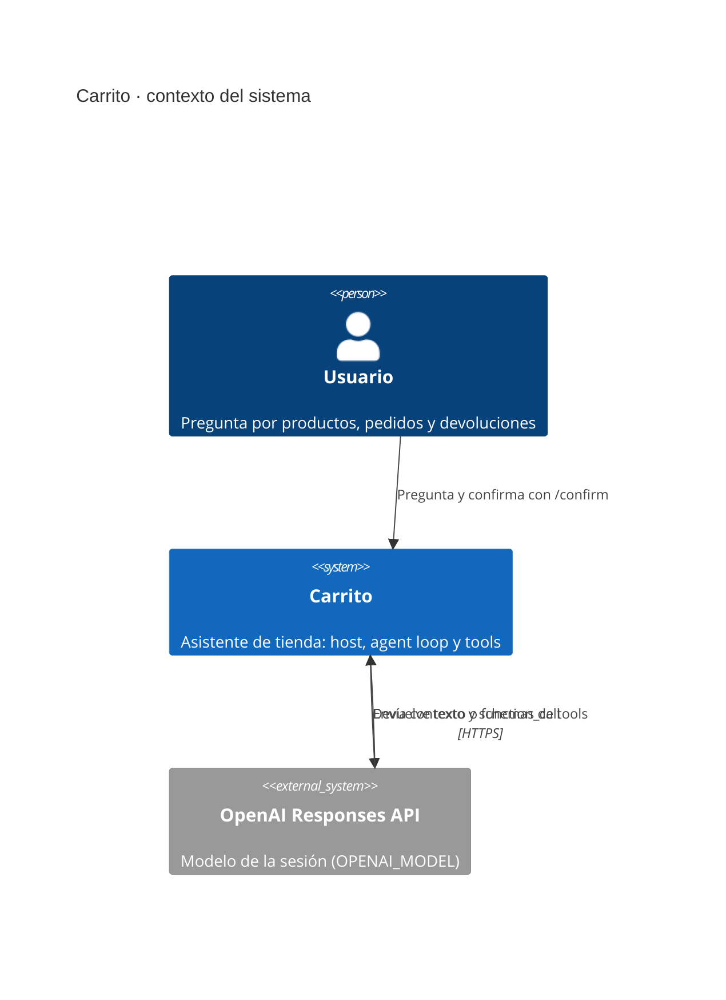
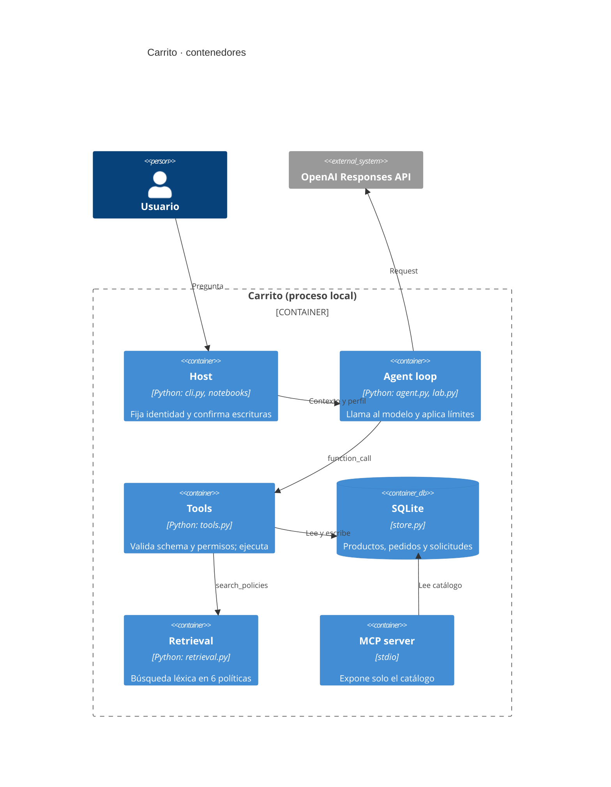

# Arquitectura · Carrito

Carrito es una aplicación pequeña. Su objetivo es separar dos cosas: qué decide el modelo y qué controla el software.

## C4 · Nivel 1: contexto

## C4 · Nivel 2: contenedores

## Cuatro tools

| Tool | Entrada que elige el modelo | Resultado o efecto |
|---|---|---|
| `search_products` | query y presupuesto opcional en EUR | Productos locales, precio en céntimos |
| `get_order` | ID de pedido | Pedido del usuario activo, o error sin datos ajenos |
| `search_policies` | query | Documentos cortos con source IDs |
| `request_return` | ID de pedido y motivo | Propuesta pendiente, o solicitud registrada tras confirmar |

El host fija la identidad. Los argumentos de una tool no pueden cambiarla.
El dispatcher valida nombres y argumentos. El modelo no ejecuta Python.

## Confirmar una solicitud

1. La tool comprueba que el pedido es del usuario y cumple las reglas de la tienda.
2. Sin confirmación, la tool prepara pedido y motivo. No escribe nada.
3. El host muestra el payload. El usuario confirma con `confirm_pending()` (o `/confirm` en el chat).
4. La tool registra la solicitud. Si cambian pedido o motivo, hace falta otra confirmación.
5. Si se repite la solicitud, la tool devuelve la misma. No crea una segunda.

La confirmación no autoriza un reembolso. El taller no maneja dinero real.

## Contexto, estado y trazas

- **Historial:** mensajes e items de la API. Cada resultado de tool va con su `call_id`.
- **`store=False`:** la API no guarda estado. El adaptador pide `reasoning.encrypted_content` para continuar con modelos de razonamiento. Es un campo opaco. [Referencia](https://developers.openai.com/api/docs/guides/reasoning).
- **Estado de negocio:** SQLite. El historial y la confirmación pendiente viven solo en la sesión.
- **Trazas JSONL:** llamadas, argumentos, resultados, usage, tiempos y motivo de salida.
- **Fin del loop:** respuesta, aclaración o límite (pasos, tools o tokens). Si se para por un límite, cada llamada pendiente recibe un resultado de error sin ejecutarse.

## Piezas compartidas por los notebooks

| Pieza | Módulo | Uso |
|---|---|---|
| `ConversationState`, `compose_context`, `RecommendationContract` | `carrito.context` | S2: contexto y contrato |
| `retrieve`, `retrieval_report` | `carrito.retrieval` | S3: retrieval medido |
| `AgentProfile`, `run_profile`, `compare_contracts` | `carrito.lab` | S3–S5: el mismo agente con perfiles |
| `live_check`, `explain_api_error` | `carrito.model` | Comprobar la clave y explicar errores |
| `FixtureModel` | `carrito.model` | S4: forzar un loop o una tool no permitida |

## Límites de esta arquitectura

Es una aplicación local de aprendizaje. Un servicio real necesita además: autenticación del host, persistencia concurrente, retención de trazas, límites de coste, recuperación de fallos y revisión humana de calidad.
LangGraph, varios agentes y memoria a largo plazo quedan fuera. Solo hacen falta para problemas más complejos.

[Evaluación](../evals/README.md) · [Código](../src/carrito/)
